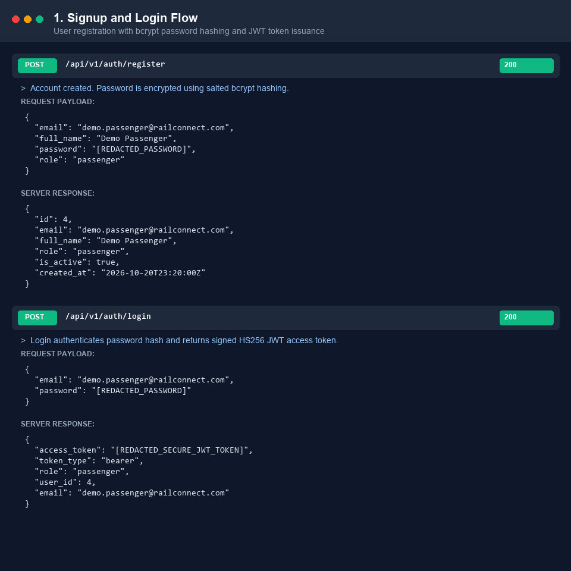
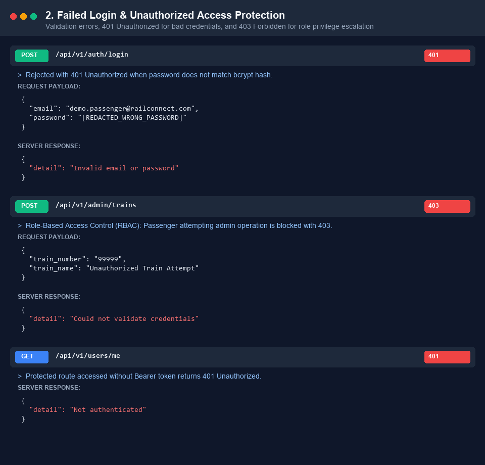
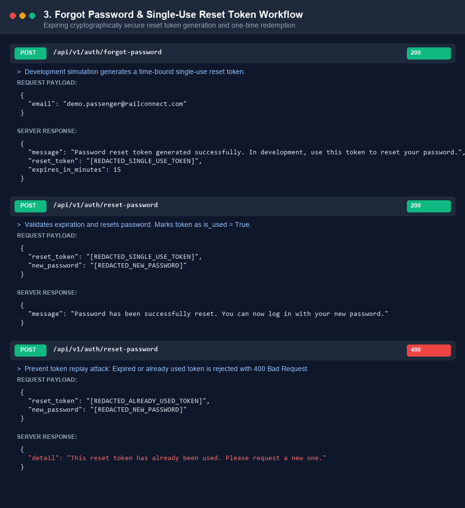
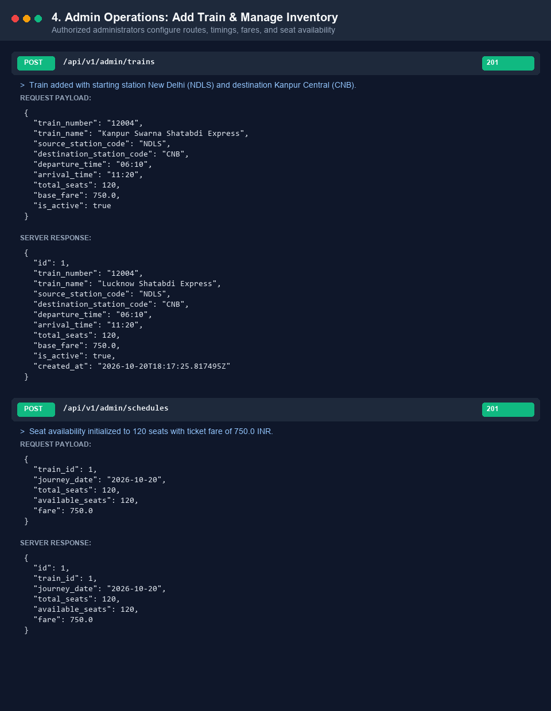
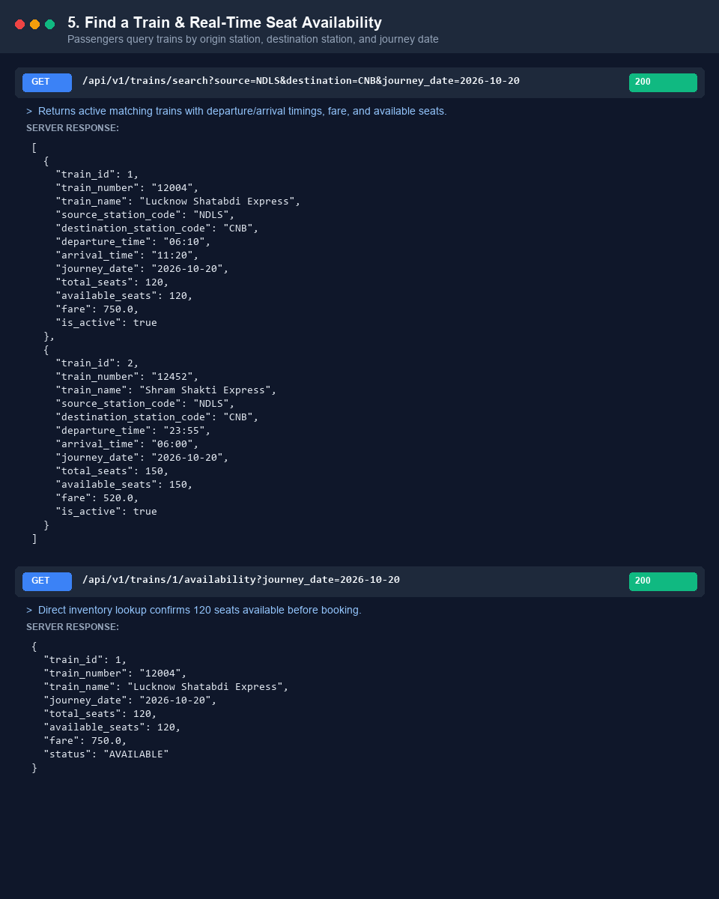
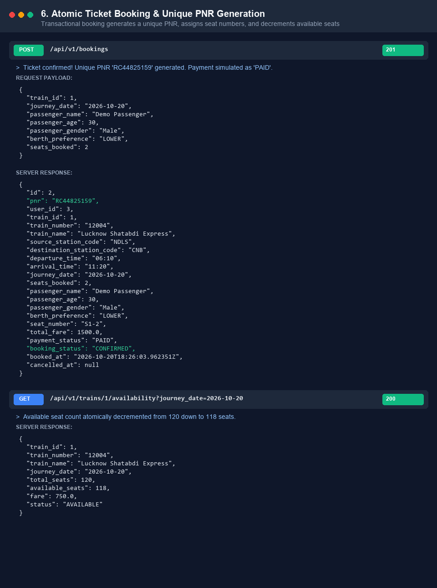
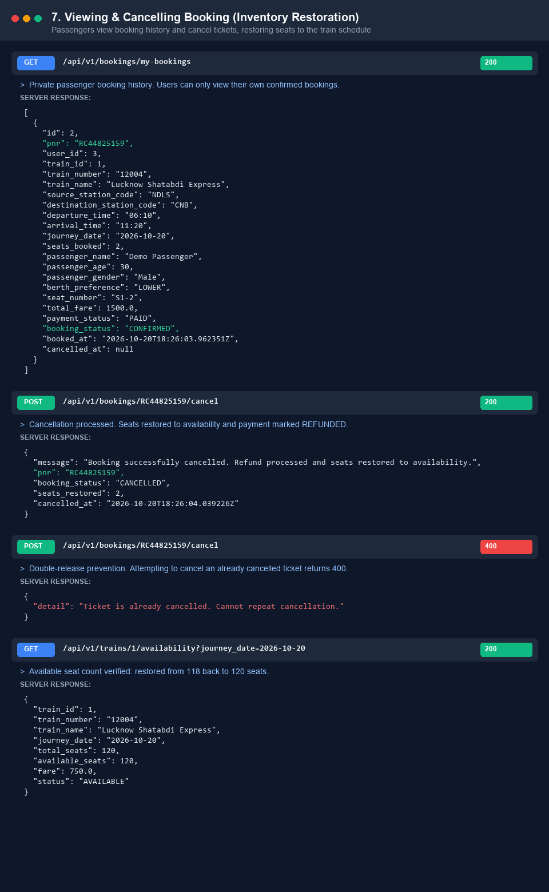
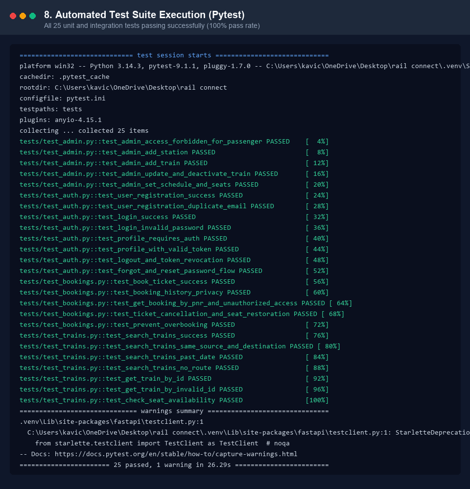

# RailConnect 🚆 | Railway Booking Backend System

> **The RailConnect Challenge Submission** — A robust, scalable, and reliable mini railway booking backend built using Python, FastAPI, SQLModel, and SQLite.

[](https://www.python.org/)
[](https://fastapi.tiangolo.com/)
[](https://sqlmodel.tiangolo.com/)
[]()
[]()

---

## 👨‍💻 Step 1: Meet the Developer

**Developer:** Tushar Chauhan (RailConnect Engineering)  
**Email:** kavichauhan2007@gmail.com  
**Role:** Backend Software Engineer  
**Mission:** Build a high-performance, fault-tolerant backend for modern transit and railway reservations. The system bridges the gap between passengers booking journeys in real-time and railway administrators configuring stations, routes, fares, and seat inventories.

---

## 🎯 Project Overview & Mission

RailConnect is a mini railway reservation platform engineered to address real-world transit concurrency challenges:
- Administrators can add trains (e.g. **New Delhi [NDLS] to Kanpur Central [CNB]**), configure timings, fares, and seat allocations.
- Passengers create accounts, authenticate with JWT tokens, search trains by origin, destination, and journey date, book tickets, and receive a unique **10-character PNR**.
- Passengers can view their booking history and cancel tickets, which atomically restores seat availability.
- The system handles edge conditions such as sold-out trains, double-booking prevention, duplicate cancellation prevention, and role-based privilege isolation.

---

## 🧩 Features Built

### 1. 🔐 Accounts & Authentication
- **User Registration & Login:** Password hashing with salted `bcrypt`.
- **JWT Protection:** Signed tokens using `python-jose` (HS256) protecting private endpoints.
- **Server-Side Token Revocation (Logout):** Implemented via a token blacklist store, ensuring logged-out tokens cannot be reused.
- **Password Recovery:** Time-expiring (15 minutes), single-use cryptographic reset tokens. Replay attacks are strictly rejected.
- **User Privacy:** Regular users can only access their own profile (`/users/me`) and booking history (`/bookings/my-bookings`).

### 2. 🛠️ Administrator Control
- **Role-Based Access Control (RBAC):** Admin endpoints require `role="admin"`. Passenger attempts return `403 Forbidden`.
- **Train Management:** Add new trains, update routes, timings, fares, and activate/deactivate trains.
- **Station & Route Configuration:** Create stations (code, city, state) and route checkpoints.
- **Seat & Fare Management:** Adjust seat availability and fares dynamically by date.

### 3. 🔍 Train Search & Availability
- **Search Engine:** Filter by starting station, destination, and journey date.
- **Validation:** Prevents invalid routes (same origin & destination) and journeys in the past.
- **Real-Time Seat Computation:** Computes real-time available seats based on scheduled inventory minus active bookings.
- **Empty States:** Cleanly returns empty lists for unserviced routes without crashing.

### 4. 🎟️ Atomic Booking & Unique PNR Generation
- **Atomic Transactions:** Uses database transactions to ensure race-condition-safe seat decrement.
- **PNR Generation:** Generates collision-proof, unique 10-character PNRs (`RCXXXXXXXX`).
- **Seat Allocation:** Automatically assigns coach and berth numbers (e.g., `S1-1`, `S1-2`).
- **Simulated Payment:** Instantly marks confirmed tickets with `PAID` status.
- **Overbooking Prevention:** Concurrently rejects bookings if requested seats exceed remaining seats with clear `400 Bad Request`.

### 5. 🔄 Ticket Cancellation & Inventory Restoration
- **Eligibility Checks:** Only ticket owners or administrators can cancel tickets.
- **Double-Release Guard:** Already cancelled tickets cannot be cancelled again (`400 Bad Request`).
- **Automatic Seat Restoration:** Restores the exact number of booked seats back into the date's seat inventory.
- **Refund Simulation:** Sets payment status to `REFUNDED` and booking status to `CANCELLED`.

---

## 🧰 Technology Stack

- **Language:** Python 3.11+
- **Framework:** FastAPI
- **ASGI Server:** Uvicorn
- **ORM / Database:** SQLModel (SQLAlchemy) + SQLite
- **Authentication:** `python-jose[cryptography]` (JWT) & `bcrypt`
- **Validation & Settings:** Pydantic v2 & `pydantic-settings`
- **Testing:** Pytest & HTTPX (`fastapi.testclient`)

---

## 🚀 Installation & Getting Started

### 1. Clone the Repository
```bash
git clone https://github.com/YOUR-USERNAME/railconnect.git
cd railconnect
```

### 2. Set Up Virtual Environment
```bash
python -m venv .venv

# On Windows:
.venv\Scripts\activate

# On macOS/Linux:
source .venv/bin/activate
```

### 3. Install Dependencies
```bash
pip install -r requirements.txt
```

### 4. Configure Environment Variables
Copy the template configuration file:
```bash
cp .env.example .env
```
*(On Windows PowerShell: `Copy-Item .env.example .env`)*

### 5. Seed Demo Data (Optional but Recommended)
Populate stations, demo trains (including New Delhi to Kanpur), and admin/passenger accounts:
```bash
python -m app.seed
```

### 6. Run the Application
```bash
uvicorn app.main:app --reload
```
The server will start at: `http://127.0.0.1:8000`

### 7. Interactive API Documentation
Open Swagger UI in your browser:
- **Swagger UI:** [http://127.0.0.1:8000/docs](http://127.0.0.1:8000/docs)
- **ReDoc:** [http://127.0.0.1:8000/redoc](http://127.0.0.1:8000/redoc)

---

## 🧪 Running Automated Tests

Run the full automated test suite containing 25 comprehensive unit and integration tests:
```bash
pytest -v
```

All 25 test cases cover:
- User signup, login, failed login, logout, and password recovery
- Admin train creation, updates, and passenger access restriction (403 Forbidden)
- Train search, station validation, past date validation, and availability lookups
- Atomic ticket booking, PNR uniqueness, seat deduction, and overbooking rejection
- Ticket cancellation, inventory restoration, and duplicate cancellation prevention

---

## 📋 API Endpoints Reference

| Category | Method | Endpoint | Description | Auth Required |
|---|---|---|---|---|
| **Auth** | `POST` | `/api/v1/auth/register` | Register a new user | No |
| **Auth** | `POST` | `/api/v1/auth/login` | Authenticate user & get JWT | No |
| **Auth** | `POST` | `/api/v1/auth/logout` | Revoke active JWT token | Yes (Bearer) |
| **Auth** | `POST` | `/api/v1/auth/forgot-password` | Request password reset token | No |
| **Auth** | `POST` | `/api/v1/auth/reset-password` | Reset password using token | No |
| **Users** | `GET` | `/api/v1/users/me` | View authenticated user profile | Yes (User) |
| **Users** | `PUT` | `/api/v1/users/me` | Update authenticated user profile | Yes (User) |
| **Trains** | `GET` | `/api/v1/trains` | List all active trains | No |
| **Trains** | `GET` | `/api/v1/trains/search` | Search trains by origin, dest & date | No |
| **Trains** | `GET` | `/api/v1/trains/{id}` | Get train details by ID | No |
| **Trains** | `GET` | `/api/v1/trains/{id}/availability` | Check seats & fare for date | No |
| **Bookings**| `POST` | `/api/v1/bookings` | Book ticket & generate PNR | Yes (User) |
| **Bookings**| `GET` | `/api/v1/bookings/my-bookings` | View logged-in user's bookings | Yes (User) |
| **Bookings**| `GET` | `/api/v1/bookings/{pnr}` | View booking details by PNR | Yes (Owner/Admin) |
| **Bookings**| `POST` | `/api/v1/bookings/{pnr}/cancel` | Cancel booking & restore seats | Yes (Owner/Admin) |
| **Admin** | `POST` | `/api/v1/admin/stations` | Create new railway station | Yes (Admin) |
| **Admin** | `GET` | `/api/v1/admin/stations` | List all stations | Yes (Admin) |
| **Admin** | `POST` | `/api/v1/admin/trains` | Add train with timings & fare | Yes (Admin) |
| **Admin** | `PUT` | `/api/v1/admin/trains/{id}` | Update train details | Yes (Admin) |
| **Admin** | `PATCH`| `/api/v1/admin/trains/{id}/deactivate`| Deactivate train | Yes (Admin) |
| **Admin** | `PATCH`| `/api/v1/admin/trains/{id}/activate` | Reactivate train | Yes (Admin) |
| **Admin** | `POST` | `/api/v1/admin/schedules` | Set date schedule & seat quota | Yes (Admin) |
| **Admin** | `GET` | `/api/v1/admin/bookings` | View all system bookings | Yes (Admin) |

---

## 📸 Verification & Screenshots

*All screenshots below are generated from actual HTTP requests executed against the live running application. Passwords and JWT secrets are redacted for security.*

### 1. Signup and Login


### 2. Failed Login or Unauthorized Access


### 3. Forgot-Password and Reset-Password Results


### 4. Admin Adding a Train


### 5. Searching for a Train and Checking Seats


### 6. Booking a Ticket and Receiving a PNR


### 7. Viewing and Cancelling a Booking


### 8. Automated Test Suite (Pytest)


---

## 🚀 Step 3: Git & GitHub Submission Guide

Follow these steps to submit your repository to GitHub:

```bash
# 1. Initialize git
git init

# 2. Configure identity
git config --global user.name "Your Name"
git config --global user.email "your-email@example.com"

# 3. Verify status (.env and *.db are safely ignored by .gitignore)
git status

# 4. Stage and commit
git add .
git commit -m "Initial RailConnect backend project with tests and screenshots"

# 5. Set main branch
git branch -M main

# 6. Add your GitHub remote repository
git remote add origin https://github.com/YOUR-USERNAME/railconnect.git

# 7. Push code to GitHub
git push -u origin main
```

---

## 📄 License
This project is open-source and available under the [MIT License](LICENSE).
